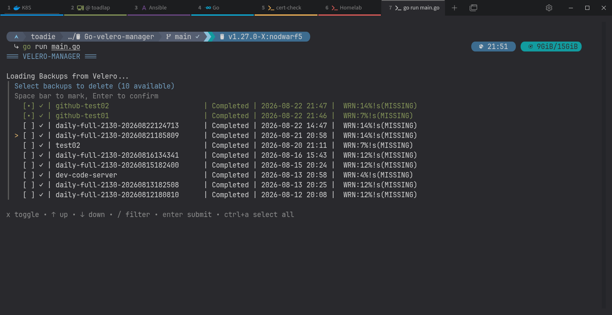

# go-velero-manager

     

Interactive TUI tool for managing [Velero](https://velero.io/) backups in [Kubernetes](https://kubernetes.io/). Built with Go and [huh](https://github.com/charmbracelet/huh).

## Features

- List all Velero backups with status, errors, warnings
- Multi-select backups for deletion
- Confirmation prompt before irreversible deletion
- Sorted by creation date (newest first)



## Requirements

- Go 1.19+
- [Velero](https://velero.io/) installed and configured
- [Kubernetes](https://kubernetes.io/) cluster access

## Install
```bash 
git clone https://github.com/toadie/velero-manager.git 
cd velero-manager go build -o velero-manager 
./velero-manager
```

Or run directly:

```bash
go run main.go
```

---
:white_check_mark: Tested and developed on [Arch Linux](https://archlinux.org/) and a [K3S](https://k3s.io/) cluster

## License
velero-manager is licensed under the [MIT License](LICENSE).